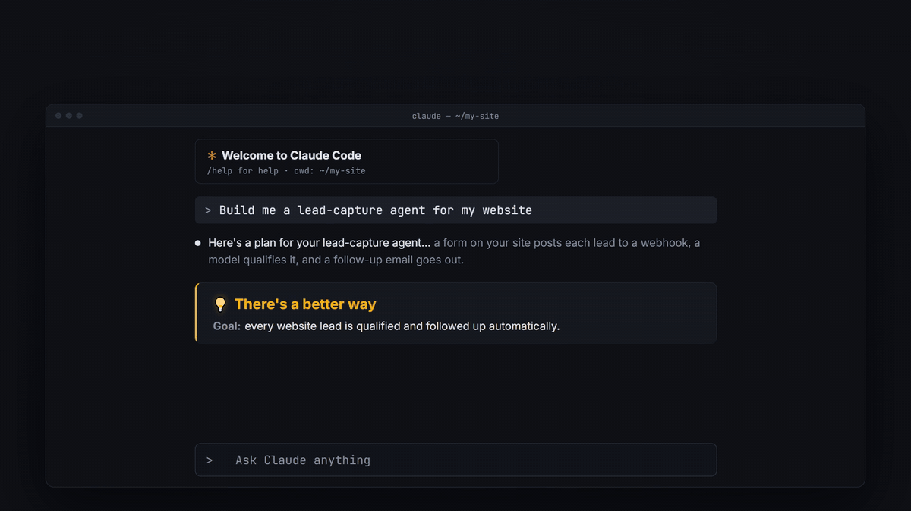

# tiabwft: There Is A Better Way For That

[](LICENSE)
[](https://github.com/costello88/tiabwft/actions/workflows/ci.yml)
[](https://github.com/costello88/tiabwft/stargazers)

**Claude does what you ask. tiabwft also tells you the better way to do it.**

A Claude Code plugin. On every prompt, Claude does your task as usual, then asks itself "is there a better way for that?" and hands you the best full stack for the job: model, automation, connectors, skills and plugins, GitHub repos, data, cost and safety. It looks the picks up live, scores them, remembers what you use and what you turned down, and gives you exactly one first step.



## Install

```bash
/plugin install tiabwft --marketplace costello88/tiabwft
```

Answer `y` to add the marketplace, then pick a scope. That's it: the next prompt already gets a suggestion. `/tiabwft off` mutes it for a session.

## What you get

Ask "Build me a lead-capture agent: people fill in a form on my website and I want the leads qualified and followed up automatically." Below your answer, Claude adds a block like this (shortened from a real eval run; the current version also shows each pick's score, for example 22/25, in the Why column):

> **💡 There's a better way**
>
> **Goal:** Every website form lead is captured, scored and followed up automatically, with a human approving anything risky.
>
> | Layer | Pick | Why | Status |
> |---|---|---|---|
> | 🤖 AI / model | Haiku for scoring, Sonnet for drafting replies | Scoring is high-volume and simple; drafts need better writing | already available |
> | ⚙️ Automation | n8n | Visual, has AI nodes, takes a form webhook directly | new |
> | 🔌 Connector: CRM | HubSpot | The agent creates and updates contacts and deals | new (needs login) |
> | 🔌 Connector: email | Gmail | Creates drafts only, so nothing is sent without you | new (needs login) |
> | 🧠 Data / memory | Postgres on Supabase | A raw lead log that survives a failed CRM or AI step | new |
> | 🛡️ Safety | Draft-only emails, narrow OAuth scopes | Form text is untrusted input | new |
>
> **Flow:** website form → n8n webhook → Supabase → Haiku scores → HubSpot → Sonnet drafts → Gmail draft for your approval → Slack alert for hot leads
>
> **Start here:** Write your 3–5 qualification criteria and the hot/nurture/reject definitions in a short note.

In short, every suggestion has:

- a **Goal** line: what you are really trying to achieve, not just the literal ask
- a **full stack table** covering every layer the job touches (often 8 to 15 rows), one specific pick per row, marked "already installed" or "new"
- a **score** per pick: the top 3 real candidates per layer, rated by fit, cost, effort, trust and lock-in (1 to 5 each), with the runners-up in an **Also considered** line
- a **Flow** line, **Alternatives** (cheapest, no-code, pro/scale) and exactly one **Start here** action

Quick one-step tasks (a typo, a rename, explaining a regex) get no block, or one line at most.

## Before and after

The same prompt, "Build me a lead-capture agent… Where do I start?", in the plugin's eval suite:

| Without tiabwft | With tiabwft |
|---|---|
| A sound plan: a webhook, one Claude call that returns JSON, code that routes by score, review emails first. Which CRM, email tool, host or monitoring to use is left to you. | The same plan, plus the named stack above: one pick per layer with its status, how the pieces chain, three alternative stacks and one concrete first step. Nothing is installed or connected without your yes. |

In that eval run (3 runs per arm, 2026-10-17), the graders scored this case 0.25 without the plugin and 0.92 with it.

## Use

| Command | What it does |
|---|---|
| `/tiabwft` | shows whether it's on |
| `/tiabwft off` | mutes suggestions for this session |
| `/tiabwft on` | turns them back on |
| `/tiabwft panel` | opens the side panel with the latest suggestion |
| `/tiabwft memory` | lists what tiabwft knows about you and this project |
| `/tiabwft remember <text>` / `/tiabwft forget <text>` | adds or removes a fact |
| `/tiabwft memory off` | pauses learning for this session |
| `/tiabwft memory reset` | clears the memory (asks you to confirm) |

The **Suggestion mode** setting (in the plugin's config) can be `always` (default), `big-asks-only` (only for goals like building or automating), or `off`.

## How it works

Claude researches live (the connector registry, plugin and skill search, GitHub, the web) and checks what you already have before it suggests anything, so it builds on your setup instead of suggesting it twice. It never names a tool, connector, repo or star count a lookup or the reference files didn't confirm.

- `hooks/register.tsx` adds a short instruction to Claude's system prompt on every turn, so the behavior is always on.
- `skills/tiabwft/SKILL.md` holds the full research method. Claude loads it for bigger goals.
- `skills/tiabwft/references/catalog.md` is a starter map from goals to connectors and skills. Edit it to add your favourites.
- `skills/tiabwft/references/community.md` maps what other people have built: the main plugin marketplaces, skill collections, awesome lists and MCP servers, plus `gh search` queries Claude runs live to find new ones.
- `skills/tiabwft/references/models-and-costs.md` covers which model to use, prices, token savers, Claude Code settings and plans.
- `skills/tiabwft/references/mcp-use-cases.md` lists jobs and the MCP servers for them in 14 domains (dev, sales, marketing, content, support, ops, finance, e-commerce, data, productivity, research, cloud, memory, automation), plus power combos and safety notes.
- `skills/tiabwft/references/build-stacks.md` is a decision guide for agent frameworks, hosting, memory/RAG, app builders and evals, with 5 ready starter stacks.
- `skills/tiabwft/references/trending-stacks.md` covers the stacks and workflows trending on YouTube and in the builder community, with hype and security warnings.

### Live session facts

Every turn, the hook also tells Claude which model is in use. It adds a tip when it's worth acting on: the context is over 60% full, the session has cost over $5, $20 or $50, over 70% of the plan's usage limit is used, or more than 80 connector tools are loaded. These lines only change when a threshold is crossed, so they don't break prompt caching.

**Note:** where an organization manages Claude Code, system-prompt hooks only run for plugins the organization lists in managed settings.

## Side panel

Next to the chat, the **💡 Better way** panel always shows the latest stack suggestion: its goal, the time and the full block, rendered as markdown. It opens when a session starts and updates after every answer that carries a 💡 block, so a tip stays visible after the chat has scrolled on. Reopen it with `/tiabwft panel`. Subagent replies and interrupted turns don't replace it.

## Memory

tiabwft learns, automatically, what you use, what you chose, what you don't want and your constraints, and uses that in every suggestion: it builds on what you have, never brings back a tool you turned down, and keeps picks within your budget.

- **Where:** this project's memory lives in `.claude/tiabwft/memory.md`, a readable file you can edit. Lines it can't read are never deleted: they move, unchanged, under a last heading `## Couldn't read (kept as written)`, which tiabwft doesn't parse. The file is only rewritten when its content changes. Your personal profile (budget, skill level, general preferences) is kept in the plugin's local storage on your computer, and only leaves it when you turn on Azure sync, which then stores both in your own Azure.
- **How:** at the start of a session it reads your connectors, `package.json`, Python files, compose files and the *names* in `.env.example`, never values. What it finds there is found again at every start, so it is never written to `memory.md`: the file holds only what you said or added, and doesn't list your connectors. After a turn with a prompt of 40 characters or more, or an answer with a 💡 block, a small model (Haiku) reads just your prompt and the final answer in the background and picks out facts worth keeping. That's roughly 3,000 tokens in and a few hundred out per turn, a fraction of a cent at Haiku prices.
- **When Claude sees it:** what tiabwft knows goes into Claude's instructions once, at the start of a session. What it learns in the background during a session updates the file and the panel right away, but reaches Claude's instructions at the next session: changing them mid-session would make Claude re-read the whole conversation at full price (it breaks prompt caching), and what you said this session is in the conversation anyway. Your own changes (`remember`, `forget`, `memory reset confirm`, ✕ in the panel) apply right away.
- **Limits:** up to 100 facts go into Claude's instructions (the panel shows 100 and `/tiabwft memory` lists 150). The background reader keeps up to 16 facts and 25 suggested names per turn, and the list of suggested names holds the last 300. A fact's text is at most 240 characters, its reason 200 and its subject 60.
- **Control:** the panel's 🧠 What I know section (open it with `/tiabwft panel`) lists everything, with ✕ to delete. `/tiabwft memory`, `/tiabwft forget <text>`, `/tiabwft remember <text>`, `/tiabwft memory off` (pause for this session) and `/tiabwft memory reset`.
- **Settings:** `memory` (`on` by default, or `off`), `projectFile` (`commit` by default, or `ignore`, which adds the file to `.gitignore`), and optional Azure sync (`azureSyncUrl`, `azureSyncKey`; both empty by default; see `azure/README.md`). Sync is used only when the URL starts with `https://`; any other URL is ignored, so the key never travels in clear. With sync on, your edits to `memory.md` win: a line you changed or deleted by hand since this checkout last synced stays that way, and that deletion reaches your other computers. Each checkout (every clone or worktree folder) keeps its own sync record, so the first sync of a new computer or a new clone only adds what Azure holds, and a fact learned elsewhere is never deleted because this copy of the file changed for another reason (a `git pull`, a fresh clone in a new folder). Re-cloning into the same folder, or a `git checkout` that removes lines this checkout already synced, counts as editing the file: those facts are treated as deleted by hand. When this checkout's `memory.md` changed since its last sync, its version of a fact wins over newer edits made elsewhere, and a fact forgotten elsewhere can come back. A project syncs across computers when it has a git remote (any host: GitHub, GitLab, Azure DevOps and so on), because the remote names it, and the git worktrees of one repo share it; without a remote, each folder gets its own memory. Azure holds the newest 450 facts per project; if there are more, the panel says so, and the older ones stay only on the computer that has them.

## Trust and privacy

Plugins run code on your machine, so here is exactly what this one does.

- **What runs:** one hook module, `hooks/register.tsx`. It adds the instruction and the live session facts to Claude's system prompt, renders the side panel, handles the `/tiabwft` commands and runs the memory feature. There is no MCP server, no daemon and no install script.
- **What it reads:** your connector and tool names, `package.json`, `requirements.txt`, `pyproject.toml`, compose files, the variable *names* in `.env.example`, and its own `.claude/tiabwft/memory.md`. It never reads values, and never reads `.env` itself.
- **What the background reader sees:** your prompt and Claude's final answer for that turn, sent to Haiku through Claude Code's own model access, the same way the rest of your session is. It is told to skip secrets, keys, tokens, passwords, email addresses and other personal data, and facts that look like secrets are filtered out before they are saved. `memory off` turns it off.
- **Where memory lives:** in `.claude/tiabwft/memory.md` in your repo (or git-ignored, with `projectFile: ignore`) and in the plugin's local storage, or, only if you set it up, in your own Azure Function over `https://`. Nothing goes anywhere else.
- **No telemetry.** tiabwft sends no usage data, analytics or crash reports to anyone.
- **Research is read-only.** The `gh search` calls and registry lookups only read. Claude never installs, connects or buys anything without your yes.

Found a security problem? See [SECURITY.md](SECURITY.md).

## Develop

151 hook tests, an eval suite in `evals/` (run with `claude plugin eval`; see [evals/README.md](evals/README.md)) and CI on every PR to `main` ([CI](.github/workflows/ci.yml)). To run the same checks locally:

```bash
claude plugin validate . && claude plugin test .
npx markdownlint-cli2 && node scripts/check-references.mjs
```

`check-references.mjs` fetches every `Source:` URL in the references and fails on a 404, so a refresh can't cite a page that doesn't exist.

## Contributing

Issues and PRs are welcome: a better pick for a reference file, a bug, an idea. See [CONTRIBUTING.md](CONTRIBUTING.md) for how to run the checks and the PR flow.

## Star history

[](https://star-history.com/#costello88/tiabwft&Date)

## License

[MIT](LICENSE)
